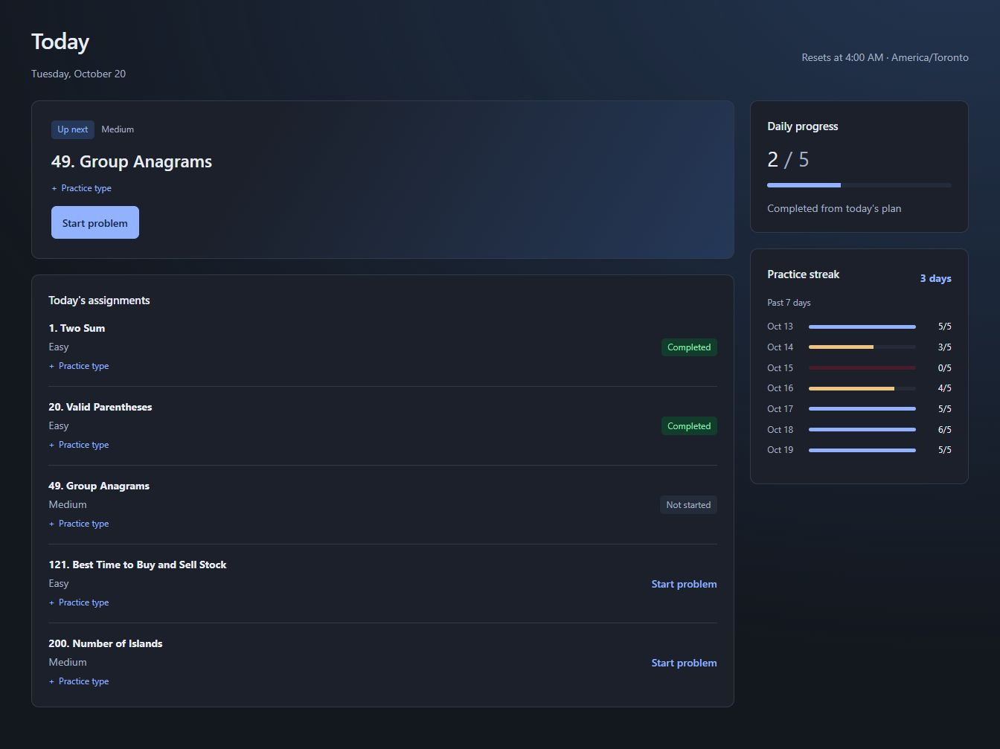
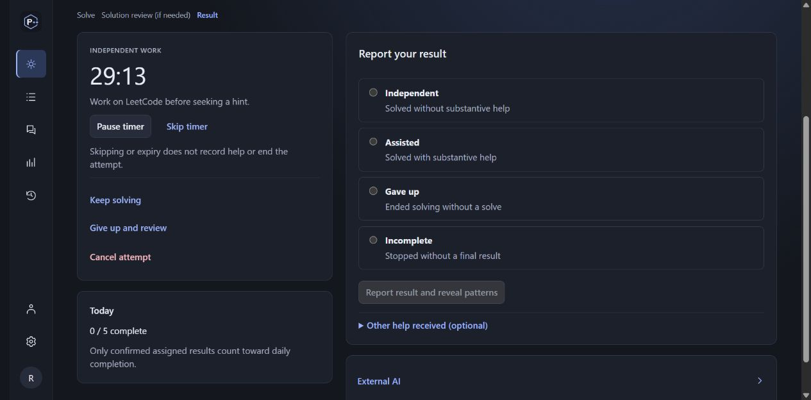
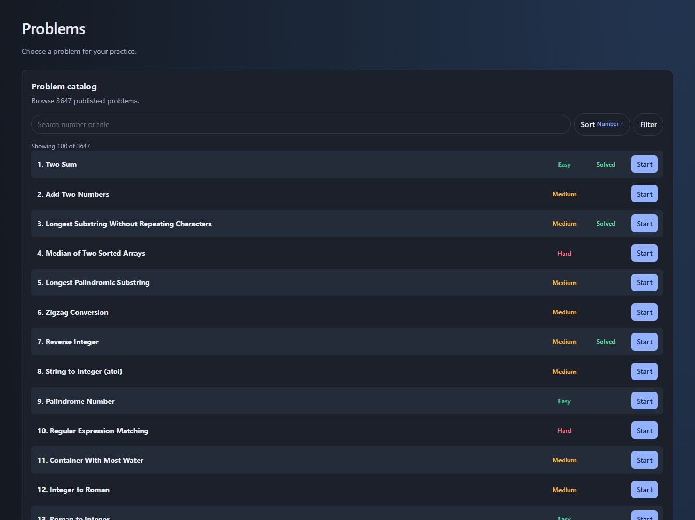
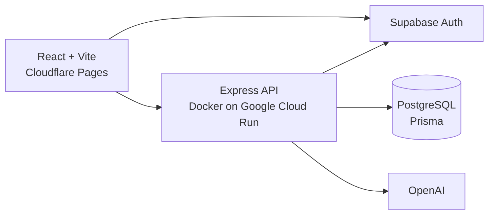

# Practice++

[practiceplusplus.com](https://practiceplusplus.com/)

Finishing the Blind 75, NeetCode 150, or LeetCode Interview 150 list leaves a question: what should you practice next? A completed list does not tell you which patterns you can recognize independently, where you still rely on hints, or what you are starting to forget.

Practice++ uses your attempt history to identify gaps and plan practice around them. Daily plans combine new problems with targeted review, helping you revisit weak areas and test your understanding on unfamiliar problems.

## Practice

A daily plan combines new problems, due reviews, and unfamiliar problems that test a previously reviewed pattern. It fits the user's daily target and stays fixed for the practice day. Timezones, day-reset times, review intervals, and due dates are configurable.

Problems open on LeetCode. The attempt timer gives the user time to work independently before seeking help. It defaults to 30 minutes and can be adjusted, paused, or skipped. The tutor offers three hint levels: a small nudge, the key idea, and an approach outline. Reviewing a full solution requires an explicit give-up, followed by an attempt to reproduce the solution from memory.

Results distinguish independent solves, assisted solves, give-ups, and incomplete attempts. The attempt workspace shows the current step: Solve, Solution review (if needed), or Result. AI can draft an assessment and marks the fields it changes, but the user confirms it before it affects history or scheduling. Problem patterns stay hidden until the user solves the problem or gives up. After a successful redo, the user can repeat it, move to a new problem with the same pattern, or stop reviewing it.

## Coaching and progress

- Coach and the attempt tutor use goals, teaching preferences, previous attempts, and learning checkpoints to provide relevant help.
- The learning profile shows what the app has inferred and the evidence behind it. Users can correct or remove memories and checkpoints.
- History is searchable by problem title or number, with attempt details in focused dialogs.
- Analytics distinguish performance on fresh problems from retention on redos. Pattern summaries show sample counts, flag insufficient evidence, and link recent practiced problems to their history. A calendar tracks completed practice against the daily target.
- Integrated AI uses the user's OpenAI key, with account-specific model discovery. Markdown context exports also support planning and tutoring in an external AI conversation. The app works without AI.
- The catalog contains 3,647 published problems, searchable by number or title and filterable by difficulty and availability. Catalog imports go through administrator review before publication.

Problem catalog

## Architecture

The project uses TypeScript throughout a pnpm monorepo.

| Package                                      | Purpose                                             |
| -------------------------------------------- | --------------------------------------------------- |
| [`apps/web`](apps/web)                       | React frontend                                      |
| [`apps/api`](apps/api)                       | Express API, Prisma persistence, and AI integration |
| [`packages/contracts`](packages/contracts)   | Shared Zod schemas and API types                    |
| [`packages/scheduling`](packages/scheduling) | Framework-independent scheduling logic              |

Scheduling runs in pure functions with explicit dates and inputs, which makes timezone boundaries, review priorities, and plan capacity testable without a database. AI can personalize fresh-problem selection, but the server validates recommendations against the same scheduling constraints. Invalid or failed integrated recommendations fall back to the deterministic planner.

Supabase handles GitHub and Google sign-in. The API verifies identity, scopes user-owned records to that identity, and enforces pattern visibility. PostgreSQL stores structured learning summaries and evidence rather than full chat transcripts or source code. AI context is assembled from bounded relational queries, without a vector database. Provider keys stay in browser memory by default, with opt-in browser storage; they are excluded from server persistence and logs.

GitHub Actions runs formatting, lint, type checks, tests against disposable PostgreSQL, workspace builds, and a Docker build. Staging migrations run before frontend deployment. Production database promotion is manual and uses a tested revision. Daily production database backups are encrypted with age and stored in a private Backblaze B2 bucket, with download hash verification after each upload.
